# StarDraft 2 changelog

StarDraft 2 is a combined map editor and EUD editor for StarCraft: Remastered, for Windows, macOS and Linux.

## 0.6.1.6

### Map

- Map properties > Crop or extend: change the map's size on a picture of the map, as with an image editor's crop
  tool. Drag the edges and corners of the rectangle to change the size, or drag the rectangle to move the map in it.
  Drag past the map's edges to make the map larger. The picture shows the map as it will be, with the new ground at
  the edges; the parts that go are dim. The size and offset fields stay, and the arrow keys move the rectangle.

  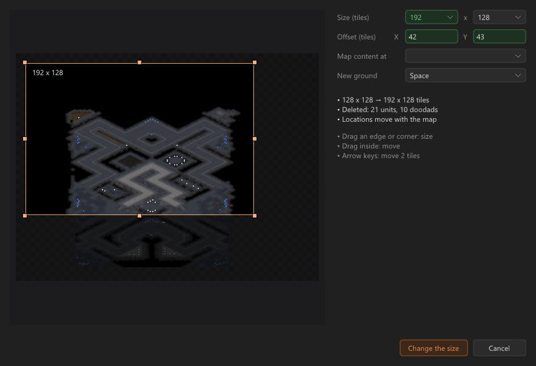
- Locations: Paste (Ctrl+V) puts the copy on the mouse, as in the other modes. Each click places it again;
  right-click or Esc stops. Each pasted location gets a name of its own (" copy1", " copy2" and so on).

  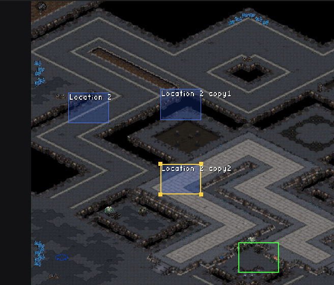
- Locations show only in Locations mode by default. View > Show locations in all modes shows them in the other modes
  too.

### The program

- Keyboard: Tab and Shift+Tab go through all parts of the main window that you can click, in screen order: the menu
  bar, the top bar, the tabs, the rail, the side bars, the map and the Log. Enter or Space presses the part, and Esc
  gives the keyboard back to the map. An outline shows the part after Tab. Tab also goes through all controls of the
  dialogs and of the "Save changes to the map?" question.
- Menus on Windows look like the system's menus. While a menu is open, move the mouse over another menu's name to
  open that menu. Submenus open next to their menu.

### Fixes

- Data > SFX data: the sounds play with StarCraft: Remastered's data too.

## 0.6.1.5

### Map

- Copy terrain or tiles in one map and paste them in another open map of the same tileset (Ctrl+C, then Ctrl+V in
  the other map's tab).

  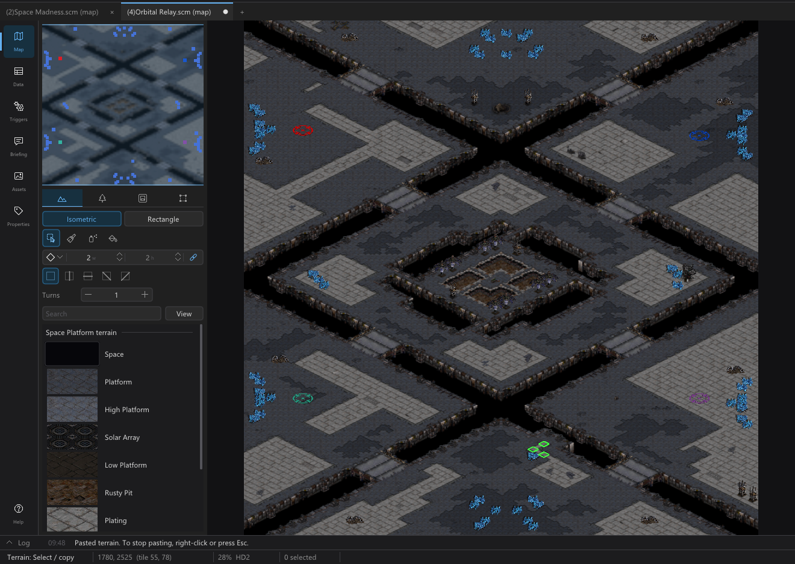
- Isometric and Rectangle each have their own brush size. A change of the size in one does not change the other.

### Fixes

- Quick picker: you can type in its search box again.
- Middle mouse button (Pan map): the map starts to move as soon as you move the mouse, with no jump and no delay.
- Map properties: the text under Change the size and tileset names StarDraft 2, not StarCraft 2. StarDraft 2
  deletes the parts of the map outside the new size; the game does not change your map.

## 0.6.1.4

### Map

- Rectangle mode: tiles that you copy from the map (Ctrl+C) become the Brush's stamp. A click places them, a drag
  repeats them in a pattern, Fill fills with them, and Shift places them at random. Ctrl+V pastes them as before.

  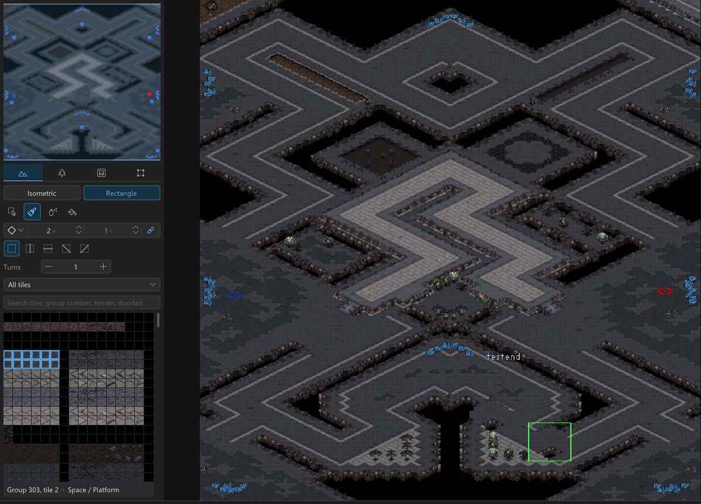
- Sprites mode has the mirrors and Turns: a placed sprite gets its mirrored and turned copies, as units and doodads do.

  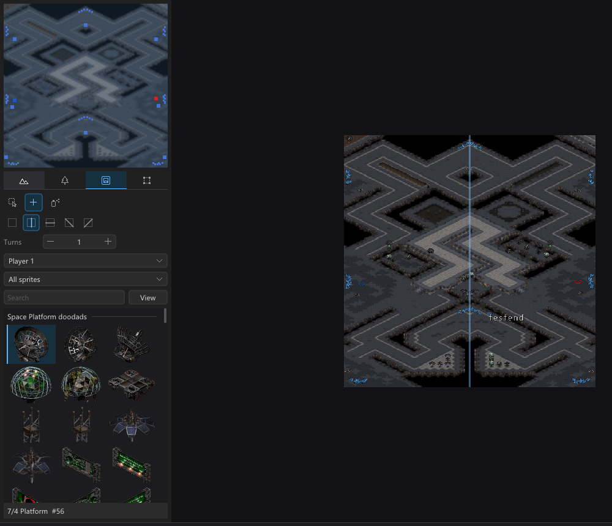
- With the mirrors or Turns on, the preview of a unit, doodad or sprite shows each copy where a click places it.

## 0.6.1.3

### Map

- Save: when a player that has units has no Start Location, or the map has fewer than 2, StarDraft 2 asks before it
  saves. Place them puts the missing Start Locations near the players' units, then saves. You can also save the map
  as it is, or cancel.

  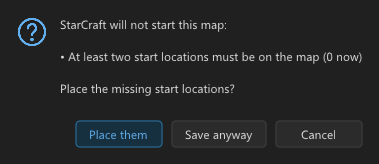
- Turns: a number from 1 to 8 replaces the half turn and quarter turn buttons. The brush and the placing draw at that
  many evenly turned places round the middle of the map. On terrain, a copy goes to the nearest diamond when the turn
  does not fit the diamonds.

  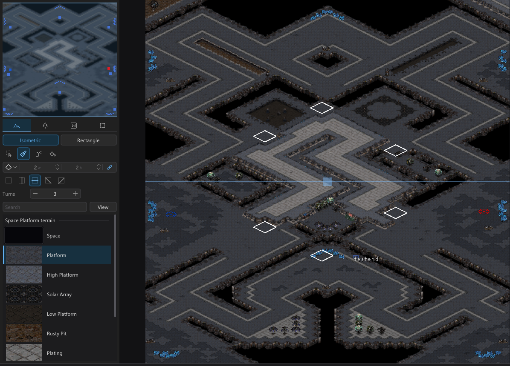
- Rectangle mode has the mirrors and the turns: the Brush, the stamp, Spray and Fill also place each tile at the
  mirrored places (the tile itself is not turned).

  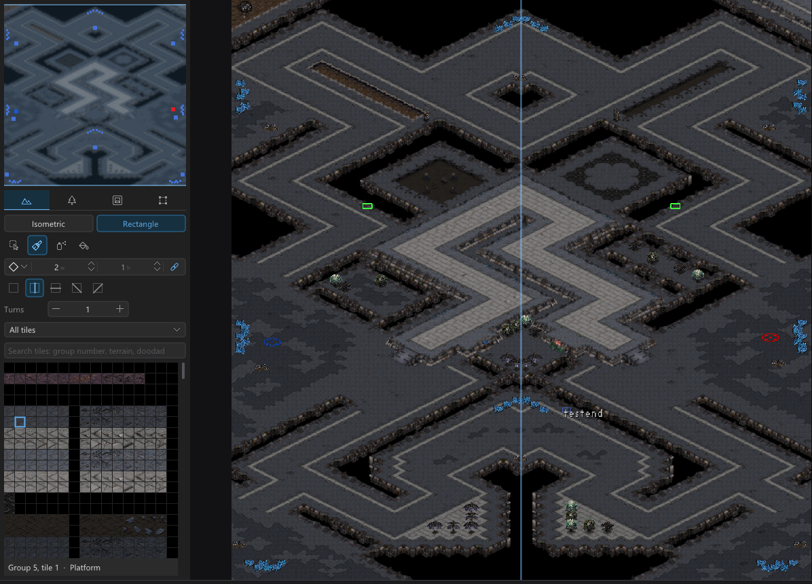
- Tiles list: drag a box over the grid (or Shift+click) to make a stamp. The Brush places those tiles, and a drag
  repeats them in a pattern; Fill fills with the pattern. Hold Shift to place them at random.

  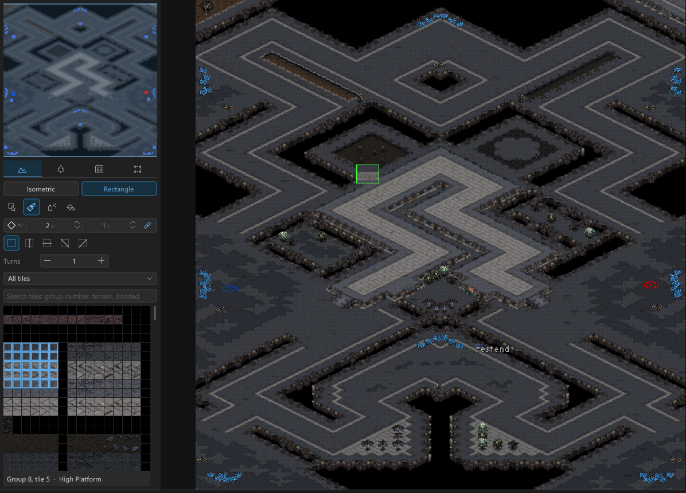
- Tiles list: the filter has sub-categories under each terrain (the terrain alone, then its edges with each other
  terrain), and the doodads' tiles under each doodad group.
- Locations: select several locations (Ctrl+click or Shift+click, also in the list, or Alt and drag over the map) and
  drag one of them to move them all. Delete, copy and paste act on all the selected locations.

  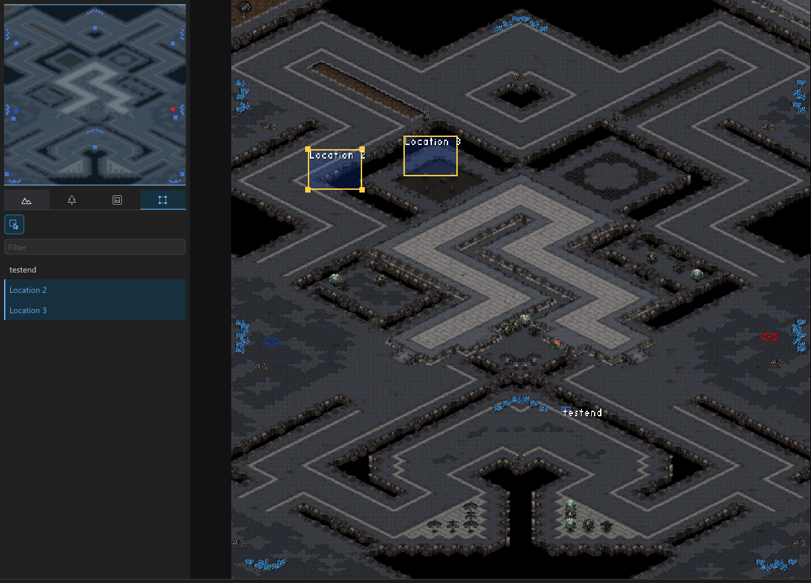
- Palettes: each palette, in the side bar or in a window, keeps its own pick, tool, brush size and shape, spray density,
  player and mirrors. Palette windows have the type box and the mode's tools, as the side bar has.

  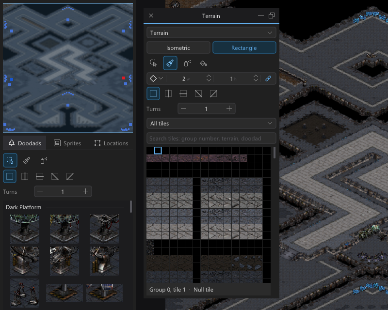
- Palettes: both side bars show their mode's tools over their list.

  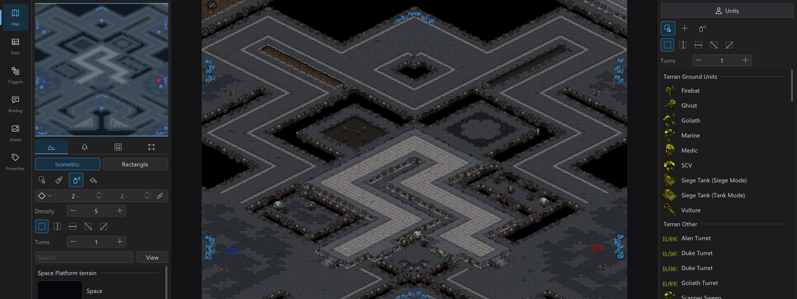
- Each map keeps its own palette windows and its Isometric or Rectangle choice.
- The minimap's bottom edge drags: make the minimap shorter, for more room under it, or taller.

  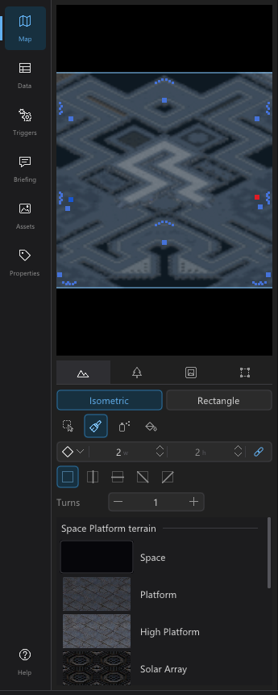

### Fixes

- Isometric terrain: the mirrors and the half turn put the copies on the exact mirrored diamonds, and a stroke at the
  middle of the map no longer paints more than the brush.

  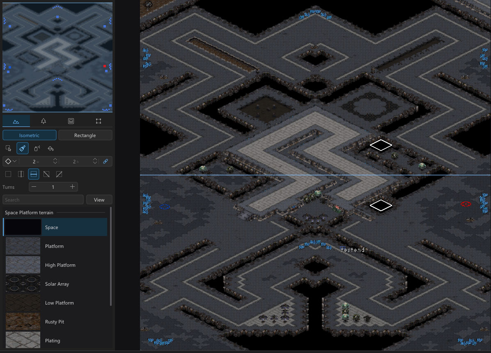
- Typing in a palette window's search box no longer runs the map's one-letter keys.
- In a floating palette, Shift+click picks every item from the last pick, as the side bar's palette does.
- On macOS, Command+click and Shift+click in a palette window work, and Command+Z undoes one step, not two.

## 0.6.1.2

### Map

- Unit properties: the window is larger, and you can change its size. It opens at its last place and size.
- Unit properties: the list of the map's units has the columns Unit type, Owner, X, Y and Index. Click a column to sort
  by it, and click it again to sort the other way.
- Unit properties: drag units in the list to change their order (their index) in the map, while the list is sorted by
  Index.
- Unit properties: Unit ID changes the type of the unit. Burrowed, Hallucinated, Cloaked and Lifted are beside
  Invincible; a state that the unit cannot have is not available.
- Unit properties: Link selected units links two Nydus Canals, or an add-on and its building. Jump to linked unit shows
  the linked unit.

  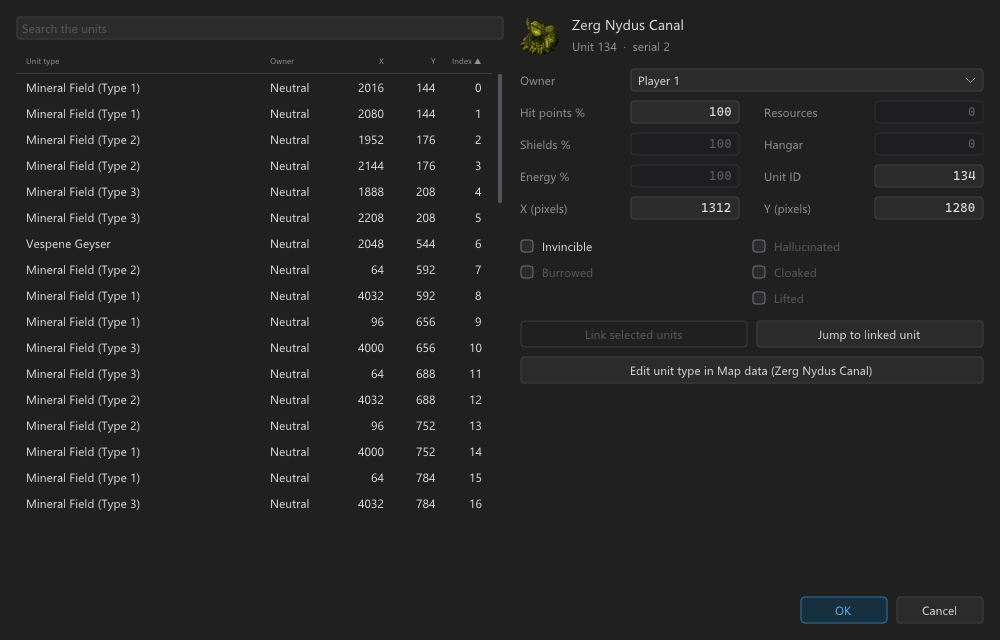

## 0.6.1.1

### Map

- Unit properties: a list of every unit of the map at the left, with its number, type, owner and place, and a search.
  Click a unit to see its properties and its place on the map. Delete deletes the selected units. View > Units list
  opens it.

  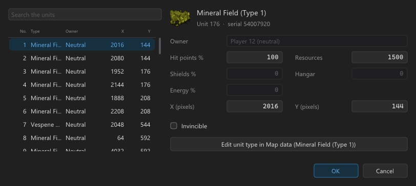
- Edit > Tools > Place map revealers: one map revealer on each square of 8 x 8 tiles, for the players that you select.
  Edit > Tools > Remove all map revealers removes them. View > Layers > Map revealers hides them on the map.

  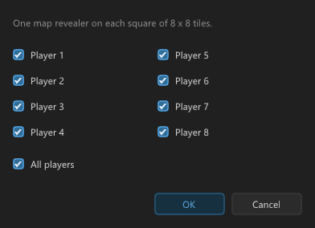

  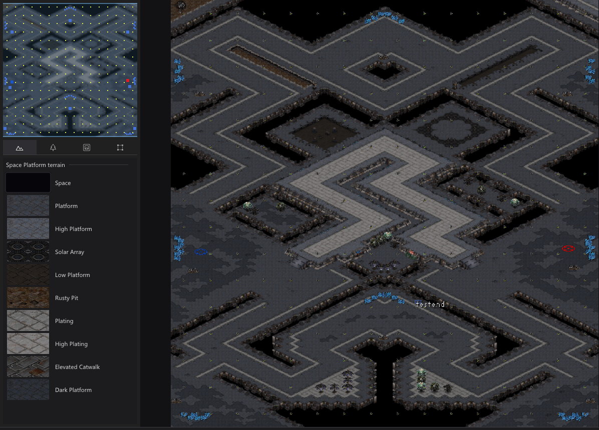
- The palette's View menu: Extra large, twice the normal size, so that you can tell the ramps and other doodads apart.

  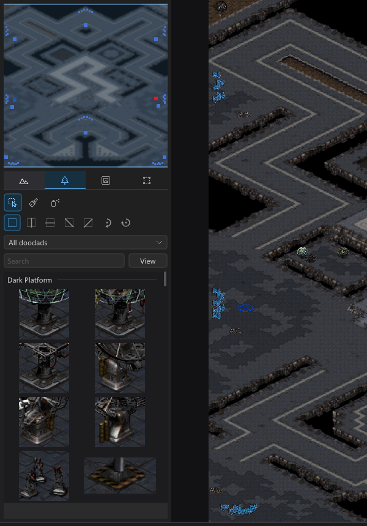
- Doodads mode: with a doodad picked, Alt+wheel picks the next or previous doodad of the palette.

### Fixes

- A palette that you moved to the other side bar picks again: before, units could not be placed and terrain could not
  be painted from it.
- A build that cannot send crash reports (as the Flatpak) tells you where the report is, and to attach it to a report
  on GitHub or Discord.

## 0.6.1

### New

- Help: a Help workspace (F1, or the last item of the side bar) with pages that explain the program and each field of
  the .dat files: what it does, its raw value and its value in game units, with the sources. Search the pages, or
  press Q. In the Data workspace, F1 opens the page of the field under the mouse. The same pages are on the website.

  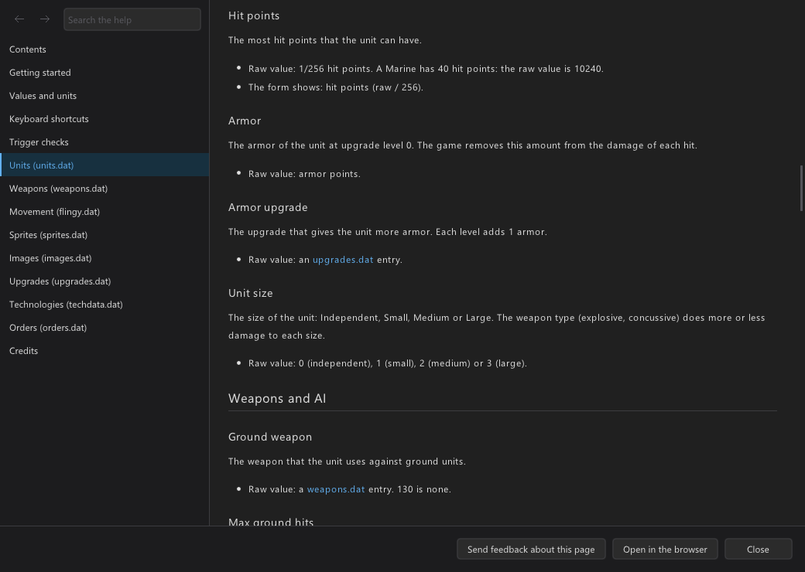
- The top bar shows Update when a new release is out. Click it to read the release notes and install. Help > What is
  new shows the notes of your version.
- File > Export map image (Ctrl+Shift+E): the whole map, the view or the selection as a PNG, up to full size in HD,
  with the units, doodads, locations and grid that you select.

  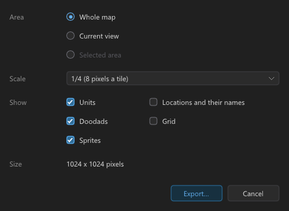
- Edit > Undo history (Ctrl+Shift+H): the list of undo steps. Click a step to go back or forward to it.
- File > Project > Import a project (experimental): import an EUD Editor 2 project (.e2s) or a euddraft project (.eds,
  .edd) as a new project, with its map, .dat edits, texts, plugins and scripts. A list shows what it could not import.
- Map properties, Players and forces, Map data and Classic triggers are items of the side bar. The Scenario menu is
  gone: its tools are in Edit > Tools. View > Workspaces lists the side bar's items and their keys.

### Map

- Floating palettes: each palette, or a mode's whole panel, can float in its own window, also on a second screen. Open
  more panels of a palette, each with its own type, filter, search and sort.

  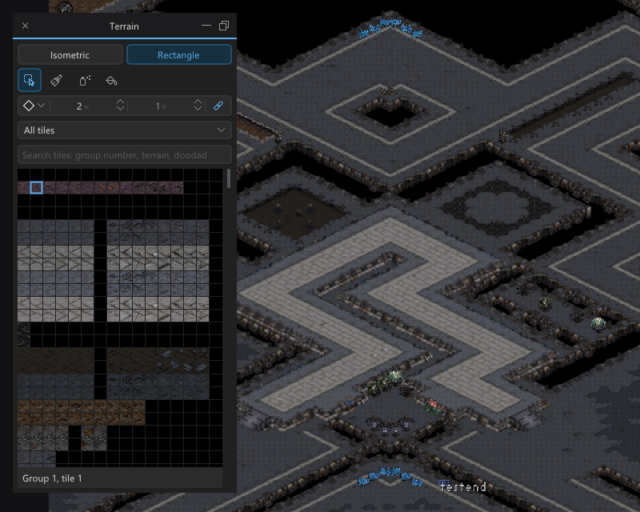
- Stacked units: Options > Units > Can be on top of others. The status bar shows how many units are under the mouse.
  Alt+click (Option+click on macOS) lists them, so that you can select one.
- Terrain: the brush paints the same tiles as StarEdit. Brush size 0.5 paints one corner.
- Rectangle mode: the Tiles list shows one tile group in each row, in the map's graphics (SD, HD or Carbot), with a
  scroll bar. Shift+click selects a rectangle of tiles.
- View > Layers > Pathing shows the game's pathing regions. Edit > Tools > Check pathing lists the places where units
  get stuck, and can fix a pocket of one tile.

  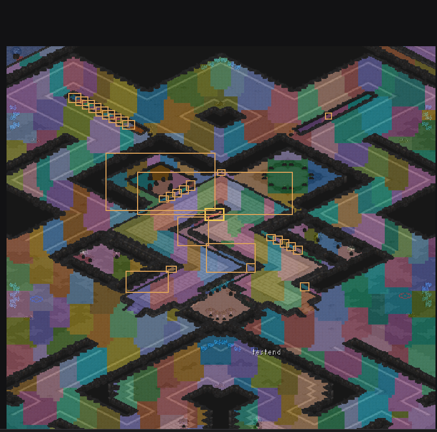
- View > Overlays: the ranges of the selected units (weapons, sight, detection, a Pylon's psi field), terrain flags
  (walkable, height, line of sight, buildable) and the fog of war of a player at the start of the game.

  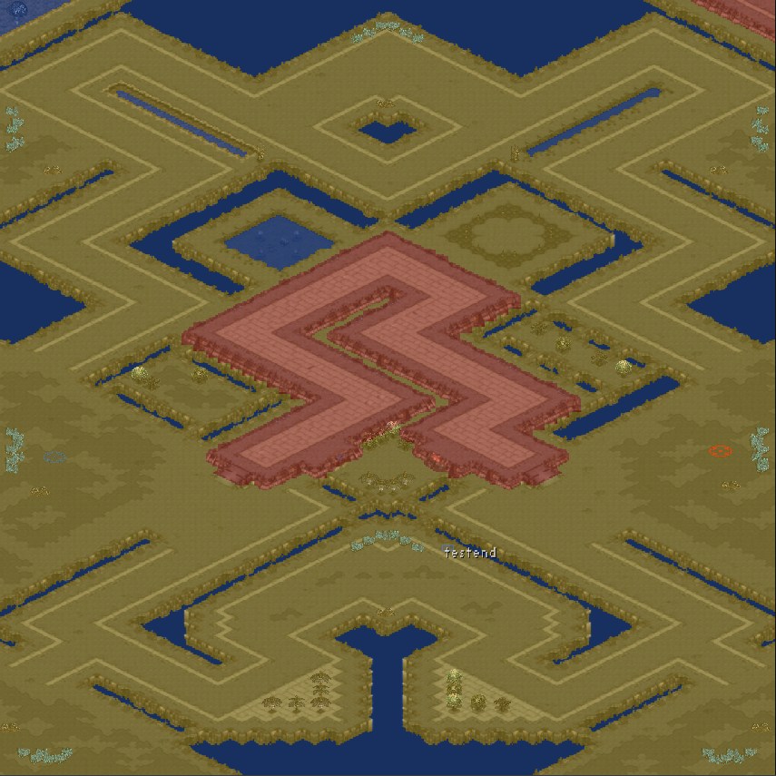

  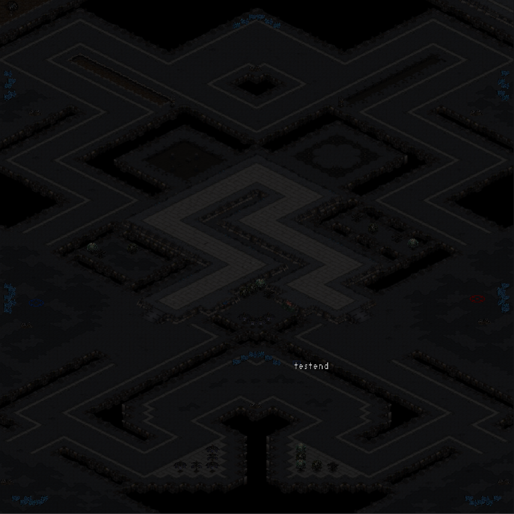
- The View menu is in groups.
- Edit > Tools > Decorate the terrain: a few, some or many doodads where they fit the terrain, in the selection or on
  the whole map. The doodad spray also puts doodads only where they fit.
- Options > Units > Keep resources 3 tiles from town halls (on by default).
- Unit properties: Edit unit type works in a classic map too. It opens the unit in Map data.
- Map data: the Changed filter, pins, copy and paste of an entry's values, and Reset, as in the Data workspace.
- New page > Generate terrain: Rules for bases (up to 8, each with a Start Location), paths between the bases, and
  bases on high ground. The preview shows the bases.

  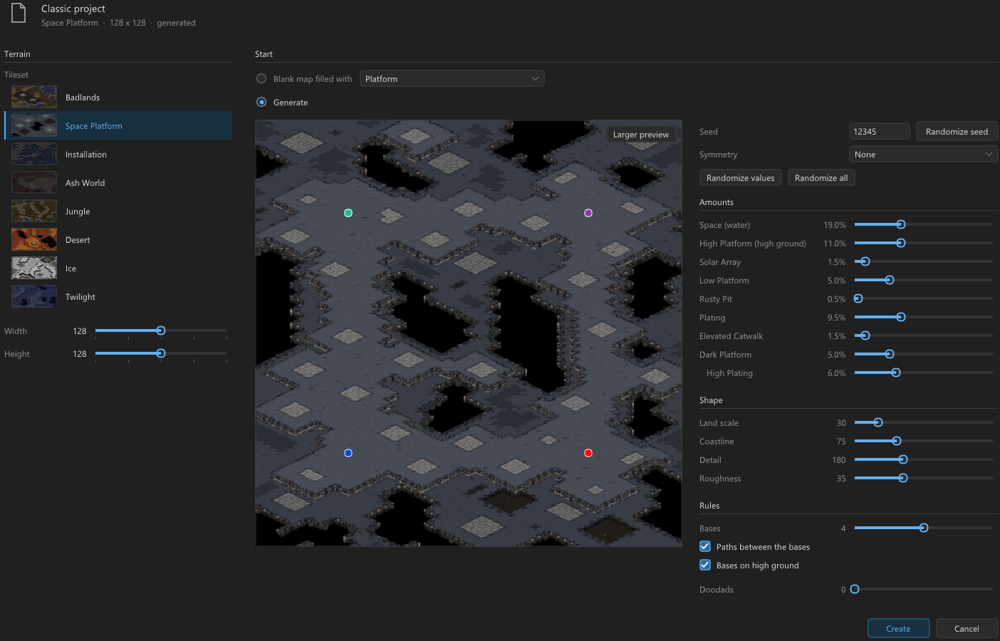
- New page > Generate terrain: Doodads, from 0 (none) to 10 (many).
- New page > Larger preview: the map in the tileset's own tiles. Export it as a PNG.

### Triggers

- Quick add: press Q in the Triggers workspace or on the Classic triggers page, and type the name of a block, condition
  or action.
- Edit > Find in triggers (Ctrl+Shift+F): find triggers, conditions, actions, blocks and comments, and go to them.
- Trigger comments: each trigger has a comment under its name. Click it to type. In the Triggers workspace, a Comment
  block is a note between the blocks.
- Classic triggers: a trigger that has only a comment is a heading. Its arrow folds the triggers under it.

  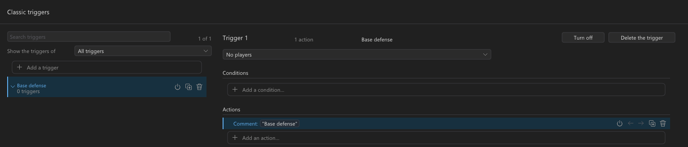
- Classic triggers: help under the selected condition or action, Ctrl+wheel zoom, and Ctrl+click or Shift+click to
  select several conditions or actions and delete them. The players of a trigger are in one dropdown.
- Triggers workspace: a NOT button on each condition.
- New blocks: Pan the camera, Shake the camera, The tile at a location, The tile at a point, Chat line starts with,
  Chat line contains, The number in the chat line, Play music, Stop the music, and Set the current player.
- Every so often stays on time in a long game.
- Help > Trigger checks: what each check looks for, with an example. Click a check's mark to open its help.

### Data

- The Data form has two columns in windows from about 1280 pixels wide.
- More values in game units: speed in pixels per second, ranges in pixels or tiles, angles in degrees and times in
  seconds.
- A project whose texts are larger than the game's stat_txt.tbl builds.

### The program

- Scroll bars on the Assets page, the Project page and the map pages.
- On macOS, Open starts in StarCraft's maps folder, Return renames in the Triggers tree, and Cmd+Backspace deletes.
- About: thanks to the people whose work StarDraft 2 uses.
- StarDraft 2 starts a little faster.

### Fixes

- Save works for a map in any folder that you can write to, also under Program Files.
- A palette no longer crashes on Linux and macOS when the map is in another mode.
- The Tiles list no longer crashes at its end.
- The quick picker in Rectangle mode no longer fills the memory.
- A Start Location no longer blocks other units.
- A map with very many pathing regions no longer stops the program.
- On macOS, typing in the quick picker no longer switches the mode.
- A click on the map while the mode's layer is hidden asks if you want to show the layer.

## 0.6.0

### New

- StarDraft 2 is now for macOS (Apple silicon) and Linux too, with the same features as on Windows.
- On macOS, the menus are in the menu bar, the shortcuts use Cmd, and save questions show on the window. Pinch and
  two-finger scroll move and zoom the map, as in Preview, and Alt + pinch sizes the brush.
- On macOS, drop a map on the Dock icon to open it. Finder shows maps in Quick Look, and the Dock icon shows the
  progress of a Build.
- On Linux, an AppImage to download and start, the system's file dialogs, and the desktop's light or dark theme. Maps
  open from the file manager in the program that is open.
- Program options > Theme and Accent color can follow the system.

### Map

- Options > Units > Snap buildings to tile edges, on by default. When it is off, buildings stay where you put them.
- Terrain mode: the keys 1 to 0 pick the first ten terrains of the list.
- Drag the edge of a side bar to make it wider or narrower.
- Location properties: type any Left, Top, Right and Bottom. The Type list follows the values, and when you pick a type
  in it, the values change to match it.

### The program

- New page > Generate terrain: Symmetry is a dropdown.
- The New page has no Back button. Use Cancel or Esc.
- Project page > Build options: Freeze protection.

### Fixes

- Quick clicks work on every button. Before, many buttons needed slow clicks.
- A double click counts only when both clicks are on the same item.
- When you quit, restart or update, StarDraft 2 asks about the changes in every tab, not only the open tab.
- Maps, projects and settings are saved to a new file first, so a full disk or a crash during a save does not empty
  the file.
- New project and New EUD project work when a project is open.
- Undo in the middle of a stroke no longer breaks the undo history.
- Text that you type in a Briefing or a map page is in the next save.
- Crash reports do not include your user name.
- If an update does not start, the version that you had stays.
- The updater no longer offers an older version to a newer build.
- The program uses less memory over a long session in the Data workspace.

### Known problems

- The text and some controls look a little different from 0.5.
- StarDraft 2 uses more memory than 0.5 (about 450 MB).
- On macOS, the app is not signed by Apple yet. The first time, right-click it and select **Open**.

## 0.5.0.8

### New

- Classic triggers: search the triggers, turn a trigger off, select several triggers with Ctrl or Shift+click, a
  right-click menu, and drag triggers and actions to put them in order.
- One editor for colored game text: the map's title and description, briefings, Data > Strings and classic trigger
  texts, with color swatches, alignment for each line, and Preview or Raw.
- New graphics for preplaced units (Project page > Build): preplaced units show your .dat edits in the game.
- Data: rename a unit, weapon, upgrade, technology or order in the game, and open its string.
- Data > Units: right-click > Paste everything copies a unit's values, display and button set onto another unit.

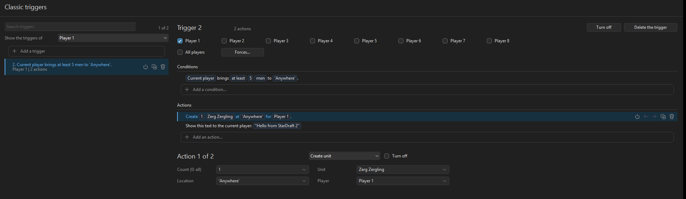

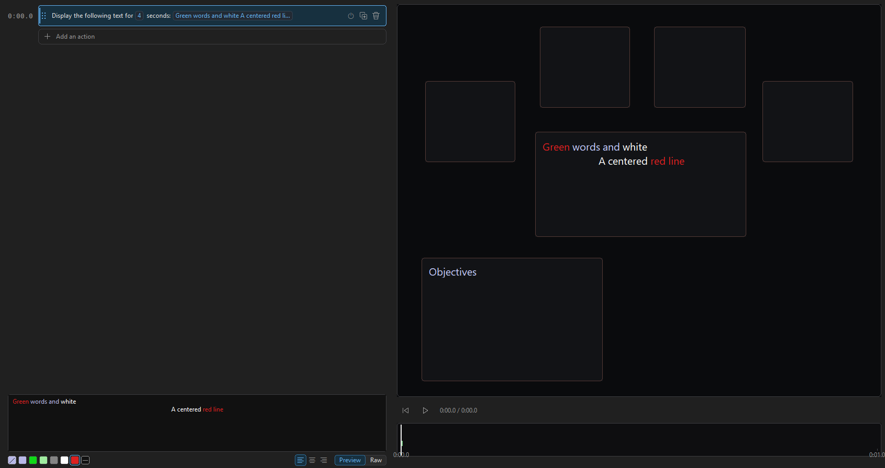

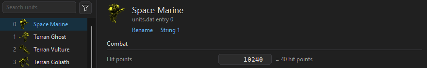

### Map

- Terrain: the brush is one field with its shape, width and height. A link keeps the height the same as the width.
- Isometric terrain: Ctrl+click a second terrain in the list, then Shift+click or Shift+drag to paint it.
- Rectangle terrain: the tile list shows the tiles in the map's art (HD or Carbot).
- Terran add-ons placed near their building go on its add-on spot and are linked to it. They move with the building.
- Doodads: pin doodads to the top of the list (right-click a doodad in a project).
- Doodads overlap only where both have tiles, so ramp segments fit together.
- The right mouse button no longer moves the map. Use the middle button.
- Opening a map or project that is open already goes to its tab.

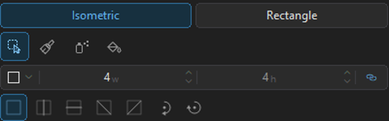

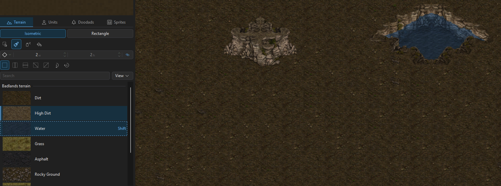

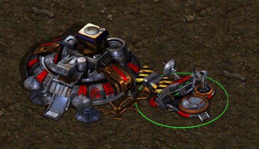

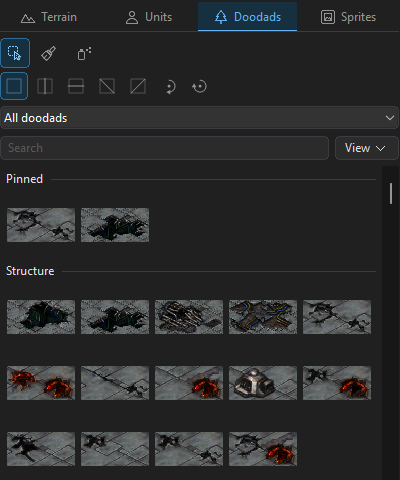

### Triggers

- Player arrays (before: "number per player") can hold unit types or locations, with a value for each player.
- New actions: center the camera on a unit, scroll lock, and set the game speed.
- New condition: a unit's build queue is empty.
- A Text variable's default value has colors, Preview and Raw.

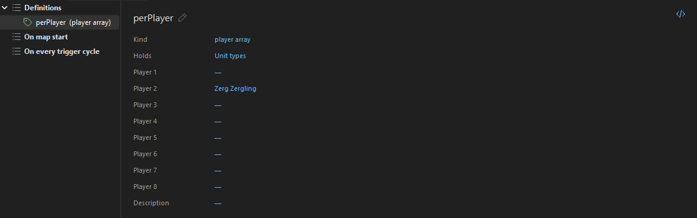

### Data

- Portraits switch fast.
- The animation timeline no longer flashes while it plays.
- The Changed filter is an icon.

### Fixes

- Feedback: Send shows its progress, then links to your GitHub issue.
- About: links to euddraft and eudplib, which StarDraft 2 uses.
- Korean, Spanish, Russian and Chinese for the texts that had no translation.

### Known problems

- Paste everything takes three undo steps and does not copy a unit's requirements.

## 0.5.0.7

### New

- New language support: Russian and Chinese (simplified).
- Quick open (Ctrl+Shift+O): jump to an open tab, or open a recent project or map.
- Drag and drop maps and projects onto the window to open them.
- Open .scm and .scx maps in StarDraft 2 with a double-click (Program options > Maps).
- Map properties: apply color to the title and description, with an inline preview.
- Data: pin entries to the top of the list (right-click an entry).
- Program options > Mouse: choose whether the middle mouse button pans or drags the map.

### Map

- Unit ranges (View > Show ranges) match the game: sight, target acquisition, ground and air. They follow units while
  you drag them.
- Siege tank turrets are drawn on top of the tank.
- Move cursor over selected units, doodads and sprites.
- No player selector in Doodads mode.
- Terrain paste fits units to the pasted terrain.
- Faster start-up, doodad spray, unit spray and paste, and minimap.

### Data

- Undo for importing, renaming and removing sounds.

### Fixes

- Very large numbers in trigger values no longer crash the program.
- Failed saves show an error; project files that fail to load are no longer overwritten.
- Damaged game string tables and tileset files show an error.
- Feedback and crash reports are no longer lost or sent twice.
- The Working folder button in Program options reads "Browse…".
- Grayed items in the Options menu are easier to read.
- Clearer texts throughout.
- The New page no longer offers "The terrain of a map".

## 0.5.0.6

### StarDraft 2

StarDraft is now StarDraft 2. The name is a homage to the original StarDraft by Camelot Systems from 1998, which
started the StarCraft modding scene. StarDraft 2 aims to be its spiritual successor for StarCraft makers in 2026 and
later. The version numbers stay as they are.

### Triggers

- No block acts only for the current player now. Victory, Defeat, Set alliance, Run an AI script and the "most" and
  "fewest" conditions have a player value: the current player by default, or a player you select (actions: also all
  players or a force).
- If and Loops are categories of the Add list. If has two blocks: If, and If / else.
- The right-click menu of a trigger has Add a condition and Add an action, with the same categories and blocks as the
  Add list.
- A click outside an open pop-out only closes it.
- Draw ends the game for all players, with no warning about the current player.

### Map

- The middle mouse button scrolls the map as before 0.5.0.2 (the farther from where you pressed, the faster).
- Ctrl+1 to Ctrl+9 go to the items of the side bar in order, also in a classic map.

## 0.5.0.5

### Map

- View > Layers: show or hide terrain, doodads, sprites, units and locations. A hidden layer cannot be edited.
- View > Show minimap: the minimap can hide, so the panel under it gets the whole side.
- The middle mouse button scrolls the map as before 0.5.0.2: the farther the mouse from where you pressed, the
  faster. A right-drag moves the map with the mouse.
- Ctrl+1 to Ctrl+9 go to the items of the side bar in order, also in a classic map (Ctrl+2 Map data, Ctrl+3 Map
  triggers).
- A paste stays on the mouse after a click: click again to paste again. Right-click or Esc stops.
- The map's title and description keep their new lines in StarCraft.

### Tiles (Rectangle mode)

- The brush size counts tiles: size 2 is 2 x 2 tiles. The size row says tiles or diamonds.
- With several tiles selected in the Tiles list, the Brush scatters them: each tile is one of them at random.
- The isometric brush paints over null tiles.

### Triggers

- If and For each buttons beside Add an action: each opens a list of its blocks.
- A click away from a value no longer leaves its chip highlighted.

### Settings and crash reports

- StarDraft keeps the options of the menus (graphics, grid, snap, doodad placing, layers, the palette's view and
  more) after a restart or an update.
- A crash keeps its report on this computer. At the next start, StarDraft asks if it can send it (Send, Always send,
  Do not send). Program options > Crash reports: Ask, Send or Do not send.

## 0.5.0.4

### Ranges on the map

View > Show ranges of the selected units: around each selected unit, its sight range (yellow), its ground weapon's
range (red) and its air weapon's range (blue). A tank's or goliath's turret counts too. EUD projects use their own
units.dat and weapons.dat.

### Tiles (Rectangle mode)

- The selection box is whole tiles while you drag it.
- Fill in the selection fills all of it. With several tiles selected in the Tiles list, each tile is one of them at
  random. The map's right-click menu also has Fill selection.
- Drag a box over tiles in the Tiles list to select them all. Ctrl+drag adds to the selection.
- Favorites: right-click a tile (or the selected tiles) in the Tiles list and select Add to favorites. The
  Favorites filter shows them. StarDraft keeps them for each tileset.

 

### Triggers

- Increase or decrease a unit's hit points, shields or energy. An increase stops at the unit's maximum. A decrease
  stops at 0, and a unit with no hit points dies.
- Order one unit: with no target (stop, hold position, burrow, siege mode …), to a location, to a point (x, y), or
  on another unit (attack, follow, repair, load, spells).
- The generated code is shorter: StarDraft's helper functions are in a file of their own (generated/sdlib.eps), and
  triggers.eps uses only the ones it needs.

### Other changes

- Enter on a selected unit opens Unit properties.
- New releases are also posted in the Discord's #general channel.

## 0.5.0.3

### Korean and Spanish

StarDraft is now in Korean (한국어) and Spanish (Español). The language follows Windows. To change it, use
Options > Program options > Language (it applies at the next start). Game names (units, weapons) stay as the game
files give them.

### Doodads

- Doodads go only on the terrain they are made for: StarDraft now checks every tile under a doodad, not only its
  top row. Doodads no longer go over the wrong terrain (for example, over rocky ground at a corner).
- Ramps and other cliff doodads go on cliffs that you paint in StarDraft, on all tilesets.
- Space Platform: Solar Array, Low Platform and Dark Platform have their correct names.

### Map pages

- Classic triggers, Map data and Players set each change in the map at once. There is no Apply button. Each change
  is one undo step.
- Map data: each weapon shows what it attacks (ground, air, or ground and air).
- Map data: to rename a unit, click the pencil button next to its name. The name shows as Program options > Unit
  names sets it.

### Other changes

- Keys for the tools of each mode: V select, B brush or place, A spray, F fill.
- Program options > Map unit limit: the most units a map can have (3400 for standard maps, 1700 for EUD projects).
  Placing, spraying and pasting units stop at the limit.
- Triggers: a new condition, "the current player is (less than, more than, exactly, …) Player N", for If blocks
  in For each player.
- New map: the buttons are Randomize seed, Randomize values and Randomize all.
- Right-click "Report feedback on …" works in the windows over the main window too (Unit properties, a location,
  Program options).

## 0.5.0.2

- The middle mouse button drags the map: the map follows the mouse, with no speed-up.
- With Spray, the map shows only the spray circle: no single unit, doodad or sprite in the middle (Spray places
  random picks around the mouse).
- The top bar's feedback button says "Report feedback".
- The start page asks for your feedback: right-click anything and select "Report feedback on …".
- The log no longer lists slow frames.

## 0.5.0.1

- Each new version is now a release of its own (0.5.0.1, 0.5.1, ...), with the version in its name.
- Help > Check for updates finds this version: a test of the update from 0.5 Alpha.

## 0.5 Alpha

The first public version. This is an alpha: please save often, keep copies of your maps, and report issues.

### Start

1. Unzip the release's zip file into a folder and run `stardraft.exe`. StarCraft: Remastered must be
   installed. StarDraft 2 reads the game's files from it (if it does not find them, use Options > Program options >
   StarCraft folder).
2. StarDraft 2 starts with a new project. File > Save asks where to keep it. A project is a folder with
   `project.stardraft`, the map, its scripts and its data changes. Double-click `project.stardraft` to open it.
3. Build (Ctrl+B) makes the map to play (`<name>_EUD.scx`). The first build downloads
   [euddraft](https://github.com/armoha/euddraft). Copy the map into StarCraft's `Maps` folder to play it.

StarDraft 2 also opens and saves regular maps (.scm, .scx) without a project.

### Maps

- Terrain brushes in different shapes and sizes, spray, fill, replace, and copy and paste with symmetry.
- Select terrain in the shape of the brush: diamond, square or circle.
- Units, doodads, sprites and locations, with snap and placement rules (Options menu).
- HD, SD and Carbot graphics.
- A new map with generated terrain (with symmetry), or with the terrain of a map that you have.
- Scenario > Map properties: the title, description, tileset and size. Scenario > Players and forces: the players.
- Show town areas (View menu): the buildable area and the resources around each base.
- Press Q to find a unit, doodad, sprite or tile by its name.

### Classic maps

- A classic trigger editor.
- The Data page: the unit, upgrade and technology settings for each player, as in the game.
- Classic maps keep up to 3,400 units, save and load, and replays.

### EUD projects

- The Data workspace edits every .dat file, the strings, requirements, button sets and the unit display. Previews
  show what each value does: ranges, the image player with its iscript, portraits and the command card.
- Triggers are blocks in plain sentences that become epScript: values from the game, loops, keys and the mouse,
  text with colors, and the game's countdown timer. A checker marks EUD errors and desyncs, and the code shows beside
  the blocks.
- Link your own .eps files. StarDraft 2 builds them as they are, and a build error names the file and the line.
- The bug button beside Build turns on debug mode: the triggers check their indexes in the game, and Build writes a
  trace file. epTrace (from euddraft) reads it while the map plays and shows which script lines use the most time.
  The Project page and the log show its report.

### Briefings and sounds

- A mission briefing editor with a preview that plays the briefing as the game plays it.
- The map's sounds play as in the game.

### The program

- A light and a dark theme, with eight accent colors.
- Options > Program options (Ctrl+,): the theme, the volume, the unit names, the start options and the StarCraft
  folder.

### Feedback and crashes

- Right-click buttons, labels, or panes and select "Report feedback on …", or use Help > Report feedback. Feedback is
  anonymous. Do not include private information.
- If StarDraft 2 crashes, it sends a crash report by itself (the version, Windows, the video card, where it crashed,
  the last log lines; no maps). Can be turned off in Program options.
- Help > Check for updates gets the newest build. StarDraft 2 also looks for one on start (Options > Program options
  to turn it off).

