# StarDraft 2 changelog

StarDraft 2 is a combined map editor and EUD editor for StarCraft: Remastered, for Windows (64-bit).

## 0.5.0.7

### New

- New language support: Russian and Chinese (simplified).
- Quick open (Ctrl+Shift+O): jump to an open tab, or open a recent project or map.
- Drag and drop maps and projects onto the window to open them.
- Open .scm and .scx maps in StarDraft 2 with a double-click (Program options > Maps).
- Map properties: apply color to the title and description, with an inline preview.
- Data: pin entries to the top of the list (right-click an entry).
- Program options > Mouse: choose whether the middle mouse button pans or drags the map.

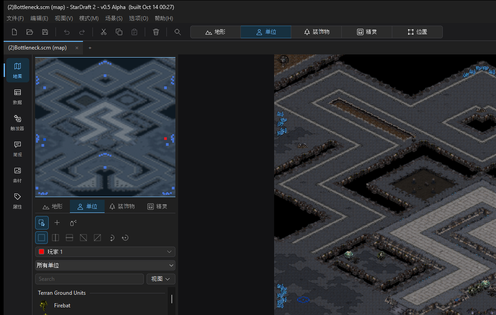

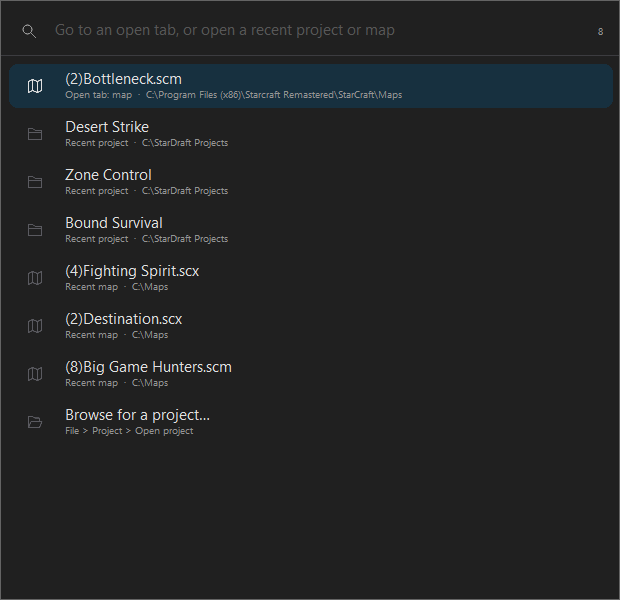

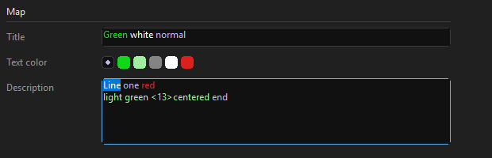

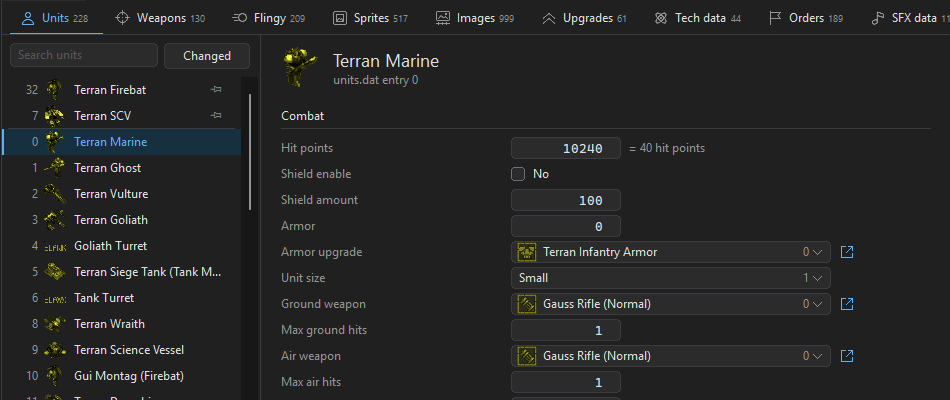

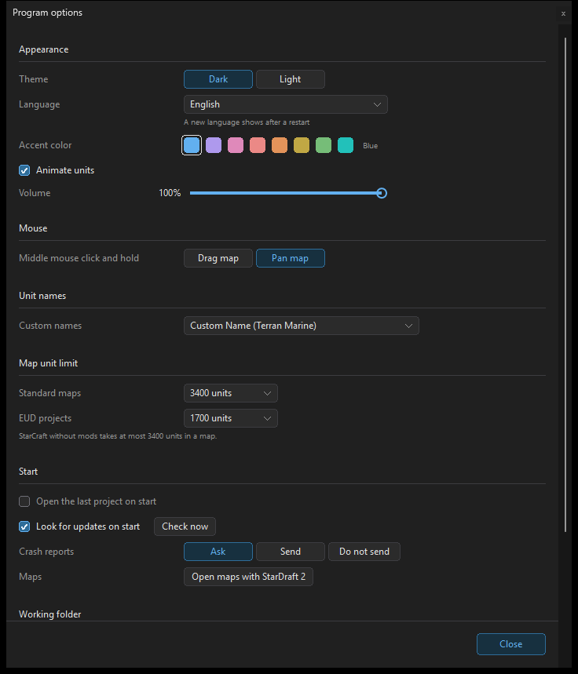

### Map

- Unit ranges (View > Show ranges) match the game: sight, target acquisition, ground and air. They follow units while
  you drag them.
- Siege tank turrets are drawn on top of the tank.
- Move cursor over selected units, doodads and sprites.
- No player selector in Doodads mode.
- Terrain paste fits units to the pasted terrain.
- Faster start-up, doodad spray, unit spray and paste, and minimap.

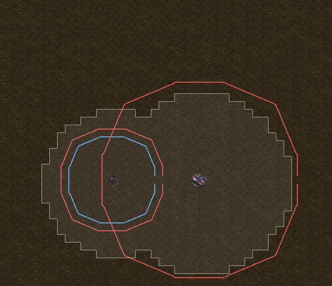

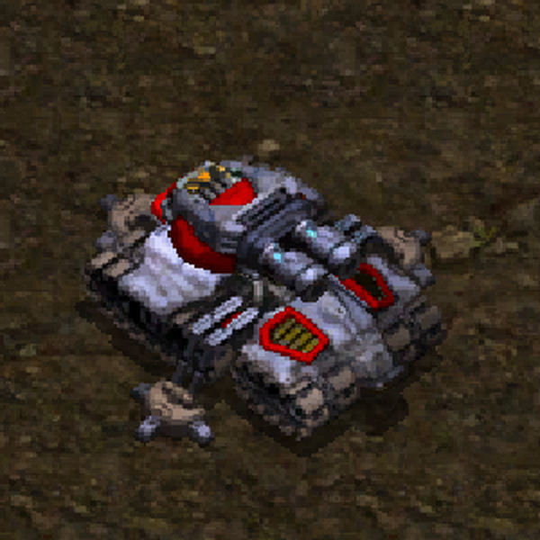

### Data

- Undo for importing, renaming and removing sounds.

### Fixes

- Very large numbers in trigger values no longer crash the program.
- Failed saves show an error; project files that fail to load are no longer overwritten.
- Damaged game string tables and tileset files show an error.
- Feedback and crash reports are no longer lost or sent twice.
- The Working folder button in Program options reads "Browse…".
- Grayed items in the Options menu are easier to read.
- Clearer texts throughout.
- The New page no longer offers "The terrain of a map".

## 0.5.0.6

### StarDraft 2

StarDraft is now StarDraft 2. The name is a homage to the original StarDraft by Camelot Systems from 1998, which
started the StarCraft modding scene. StarDraft 2 aims to be its spiritual successor for StarCraft makers in 2026 and
later. The version numbers stay as they are.

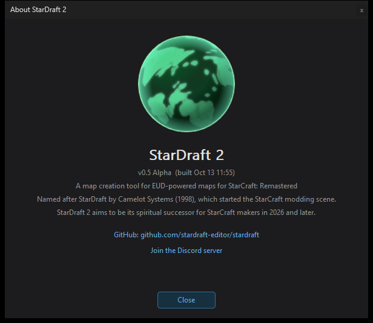

### Triggers

- No block acts only for the current player now. Victory, Defeat, Set alliance, Run an AI script and the "most" and
  "fewest" conditions have a player value: the current player by default, or a player you select (actions: also all
  players or a force).
- If and Loops are categories of the Add list. If has two blocks: If, and If / else.
- The right-click menu of a trigger has Add a condition and Add an action, with the same categories and blocks as the
  Add list.
- A click outside an open pop-out only closes it.
- Draw ends the game for all players, with no warning about the current player.

### Map

- The middle mouse button scrolls the map as before 0.5.0.2 (the farther from where you pressed, the faster).
- Ctrl+1 to Ctrl+9 go to the items of the side bar in order, also in a classic map.

## 0.5.0.5

### Map

- View > Layers: show or hide terrain, doodads, sprites, units and locations. A hidden layer cannot be edited.
- View > Show minimap: the minimap can hide, so the panel under it gets the whole side.
- The middle mouse button scrolls the map as before 0.5.0.2: the farther the mouse from where you pressed, the
  faster. A right-drag moves the map with the mouse.
- Ctrl+1 to Ctrl+9 go to the items of the side bar in order, also in a classic map (Ctrl+2 Map data, Ctrl+3 Map
  triggers).
- A paste stays on the mouse after a click: click again to paste again. Right-click or Esc stops.
- The map's title and description keep their new lines in StarCraft.

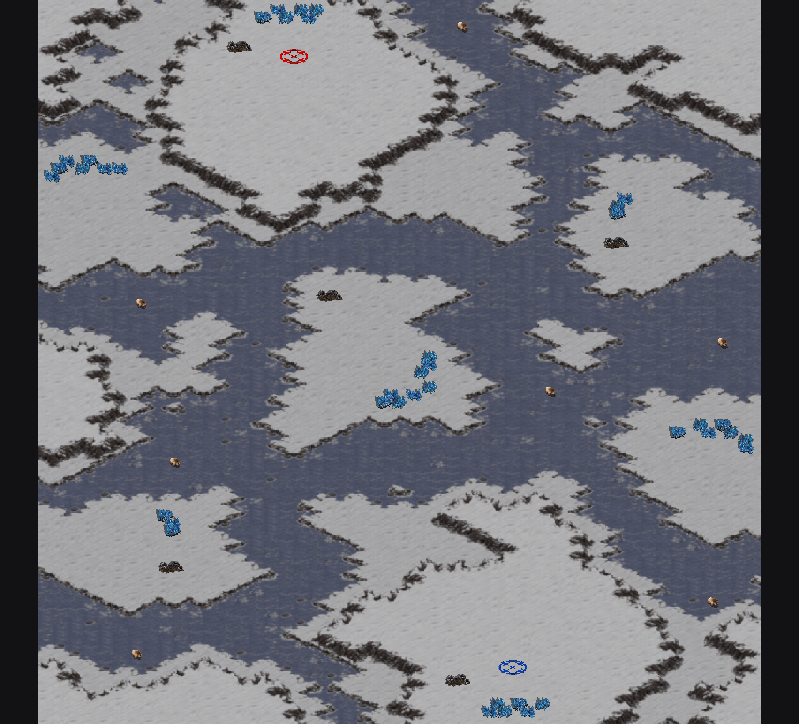

### Tiles (Rectangle mode)

- The brush size counts tiles: size 2 is 2 x 2 tiles. The size row says tiles or diamonds.
- With several tiles selected in the Tiles list, the Brush scatters them: each tile is one of them at random.
- The isometric brush paints over null tiles.

### Triggers

- If and For each buttons beside Add an action: each opens a list of its blocks.
- A click away from a value no longer leaves its chip highlighted.

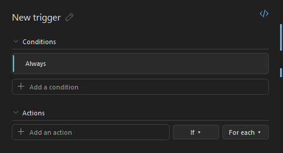

### Settings and crash reports

- StarDraft keeps the options of the menus (graphics, grid, snap, doodad placing, layers, the palette's view and
  more) after a restart or an update.
- A crash keeps its report on this computer. At the next start, StarDraft asks if it can send it (Send, Always send,
  Do not send). Program options > Crash reports: Ask, Send or Do not send.

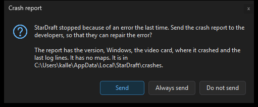

## 0.5.0.4

### Ranges on the map

View > Show ranges of the selected units: around each selected unit, its sight range (yellow), its ground weapon's
range (red) and its air weapon's range (blue). A tank's or goliath's turret counts too. EUD projects use their own
units.dat and weapons.dat.

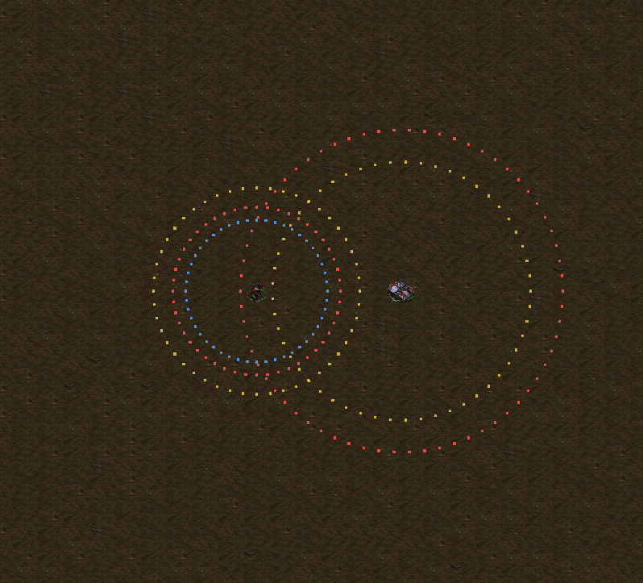

### Tiles (Rectangle mode)

- The selection box is whole tiles while you drag it.
- Fill in the selection fills all of it. With several tiles selected in the Tiles list, each tile is one of them at
  random. The map's right-click menu also has Fill selection.
- Drag a box over tiles in the Tiles list to select them all. Ctrl+drag adds to the selection.
- Favorites: right-click a tile (or the selected tiles) in the Tiles list and select Add to favorites. The
  Favorites filter shows them. StarDraft keeps them for each tileset.

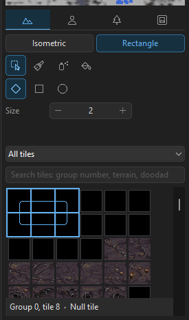 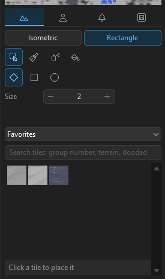

### Triggers

- Increase or decrease a unit's hit points, shields or energy. An increase stops at the unit's maximum. A decrease
  stops at 0, and a unit with no hit points dies.
- Order one unit: with no target (stop, hold position, burrow, siege mode …), to a location, to a point (x, y), or
  on another unit (attack, follow, repair, load, spells).
- The generated code is shorter: StarDraft's helper functions are in a file of their own (generated/sdlib.eps), and
  triggers.eps uses only the ones it needs.

### Other changes

- Enter on a selected unit opens Unit properties.
- New releases are also posted in the Discord's #general channel.

## 0.5.0.3

### Korean and Spanish

StarDraft is now in Korean (한국어) and Spanish (Español). The language follows Windows. To change it, use
Options > Program options > Language (it applies at the next start). Game names (units, weapons) stay as the game
files give them.

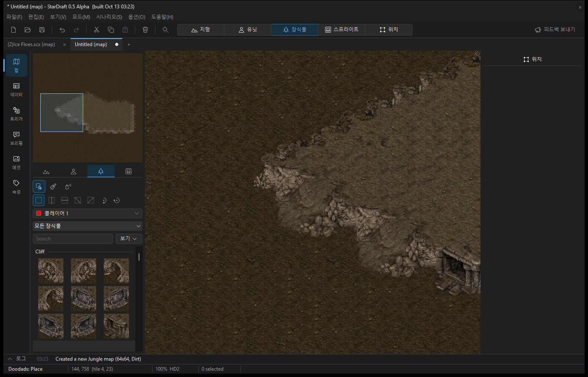

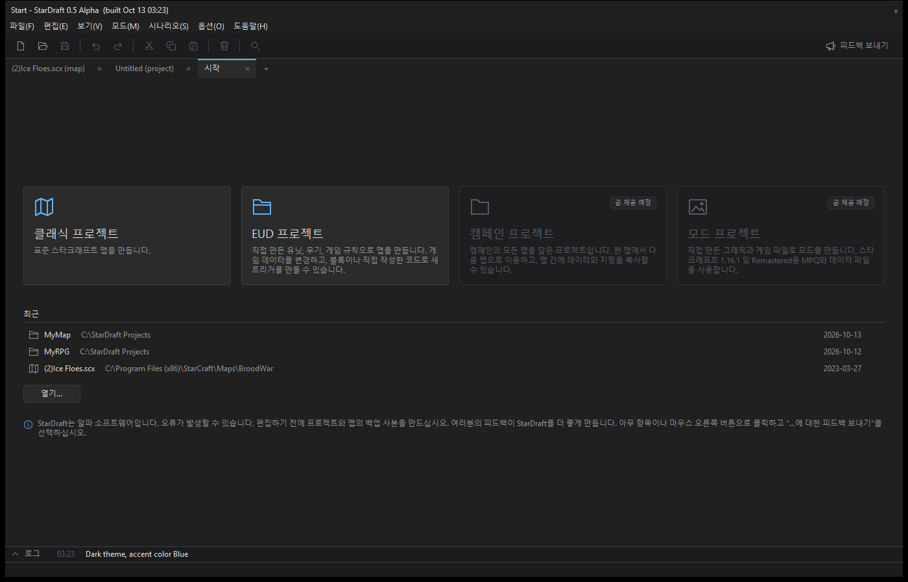

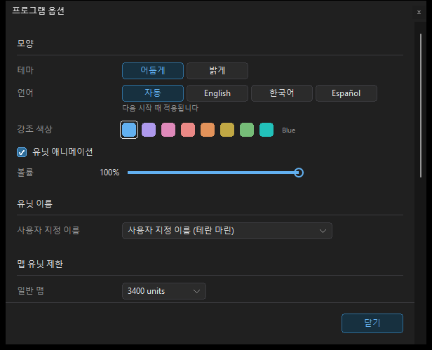

### Doodads

- Doodads go only on the terrain they are made for: StarDraft now checks every tile under a doodad, not only its
  top row. Doodads no longer go over the wrong terrain (for example, over rocky ground at a corner).
- Ramps and other cliff doodads go on cliffs that you paint in StarDraft, on all tilesets.
- Space Platform: Solar Array, Low Platform and Dark Platform have their correct names.

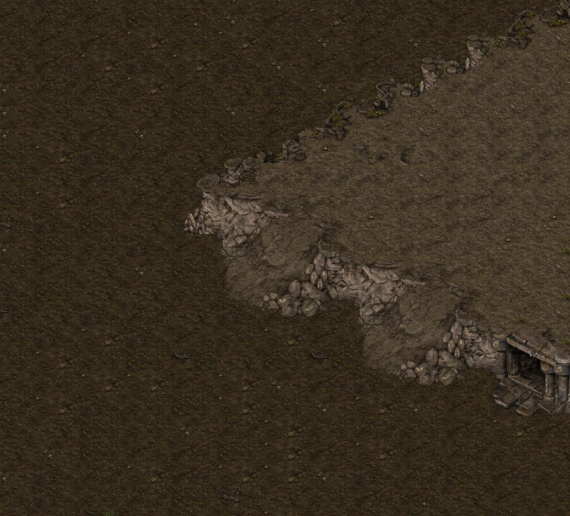

### Map pages

- Classic triggers, Map data and Players set each change in the map at once. There is no Apply button. Each change
  is one undo step.
- Map data: each weapon shows what it attacks (ground, air, or ground and air).
- Map data: to rename a unit, click the pencil button next to its name. The name shows as Program options > Unit
  names sets it.

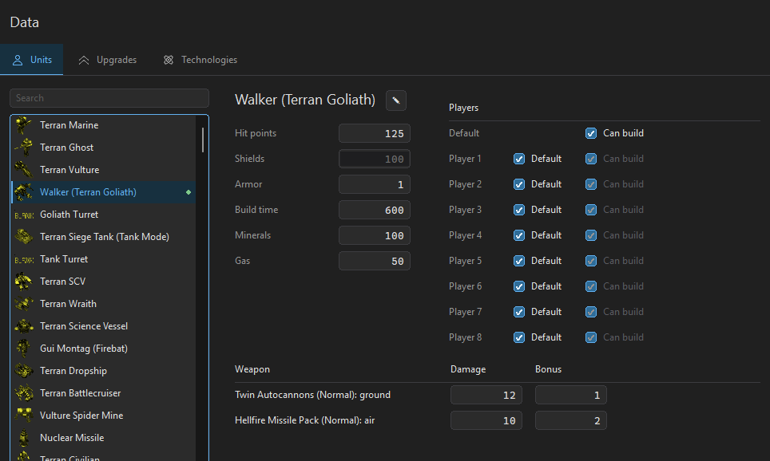

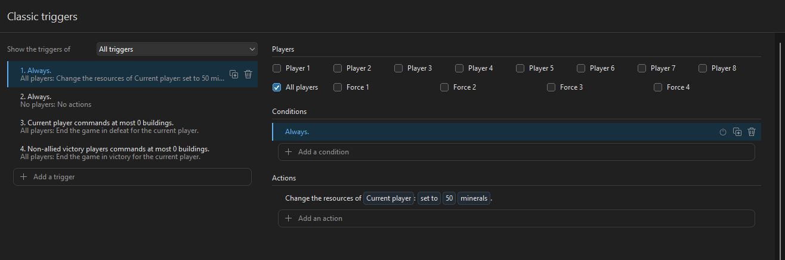

### Other changes

- Keys for the tools of each mode: V select, B brush or place, A spray, F fill.
- Program options > Map unit limit: the most units a map can have (3400 for standard maps, 1700 for EUD projects).
  Placing, spraying and pasting units stop at the limit.
- Triggers: a new condition, "the current player is (less than, more than, exactly, …) Player N", for If blocks
  in For each player.
- New map: the buttons are Randomize seed, Randomize values and Randomize all.
- Right-click "Report feedback on …" works in the windows over the main window too (Unit properties, a location,
  Program options).

## 0.5.0.2

- The middle mouse button drags the map: the map follows the mouse, with no speed-up.
- With Spray, the map shows only the spray circle: no single unit, doodad or sprite in the middle (Spray places
  random picks around the mouse).
- The top bar's feedback button says "Report feedback".
- The start page asks for your feedback: right-click anything and select "Report feedback on …".
- The log no longer lists slow frames.

## 0.5.0.1

- Each new version is now a release of its own (0.5.0.1, 0.5.1, ...), with the version in its name.
- Help > Check for updates finds this version: a test of the update from 0.5 Alpha.

## 0.5 Alpha

The first public version. This is an alpha: please save often, keep copies of your maps, and report issues.

### Start

1. Unzip the release's zip file into a folder and run `stardraft.exe`. StarCraft: Remastered must be
   installed. StarDraft 2 reads the game's files from it (if it does not find them, use Options > Program options >
   StarCraft folder).
2. StarDraft 2 starts with a new project. File > Save asks where to keep it. A project is a folder with
   `project.stardraft`, the map, its scripts and its data changes. Double-click `project.stardraft` to open it.
3. Build (Ctrl+B) makes the map to play (`<name>_EUD.scx`). The first build downloads
   [euddraft](https://github.com/armoha/euddraft). Copy the map into StarCraft's `Maps` folder to play it.

StarDraft 2 also opens and saves regular maps (.scm, .scx) without a project.

### Maps

- Terrain brushes in different shapes and sizes, spray, fill, replace, and copy and paste with symmetry.
- Select terrain in the shape of the brush: diamond, square or circle.
- Units, doodads, sprites and locations, with snap and placement rules (Options menu).
- HD, SD and Carbot graphics.
- A new map with generated terrain (with symmetry), or with the terrain of a map that you have.
- Scenario > Map properties: the title, description, tileset and size. Scenario > Players and forces: the players.
- Show town areas (View menu): the buildable area and the resources around each base.
- Press Q to find a unit, doodad, sprite or tile by its name.

### Classic maps

- A classic trigger editor.
- The Data page: the unit, upgrade and technology settings for each player, as in the game.
- Classic maps keep up to 3,400 units, save and load, and replays.

### EUD projects

- The Data workspace edits every .dat file, the strings, requirements, button sets and the unit display. Previews
  show what each value does: ranges, the image player with its iscript, portraits and the command card.
- Triggers are blocks in plain sentences that become epScript: values from the game, loops, keys and the mouse,
  text with colors, and the game's countdown timer. A checker marks EUD errors and desyncs, and the code shows beside
  the blocks.
- Link your own .eps files. StarDraft 2 builds them as they are, and a build error names the file and the line.
- The bug button beside Build turns on debug mode: the triggers check their indexes in the game, and Build writes a
  trace file. epTrace (from euddraft) reads it while the map plays and shows which script lines use the most time.
  The Project page and the log show its report.

### Briefings and sounds

- A mission briefing editor with a preview that plays the briefing as the game plays it.
- The map's sounds play as in the game.

### The program

- A light and a dark theme, with eight accent colors.
- Options > Program options (Ctrl+,): the theme, the volume, the unit names, the start options and the StarCraft
  folder.

### Feedback and crashes

- Right-click buttons, labels, or panes and select "Report feedback on …", or use Help > Report feedback. Feedback is
  anonymous. Do not include private information.
- If StarDraft 2 crashes, it sends a crash report by itself (the version, Windows, the video card, where it crashed,
  the last log lines; no maps). Can be turned off in Program options.
- Help > Check for updates gets the newest build. StarDraft 2 also looks for one on start (Options > Program options
  to turn it off).

